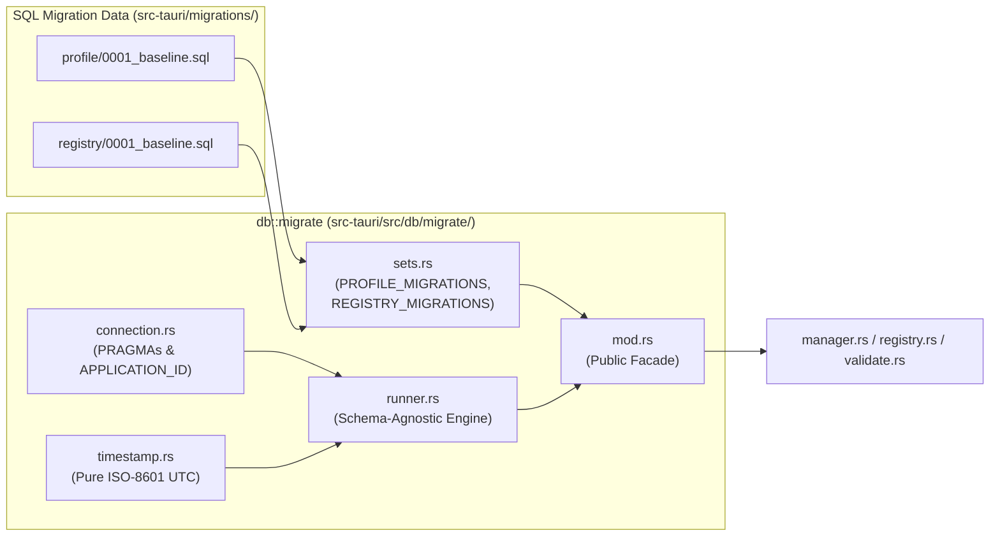
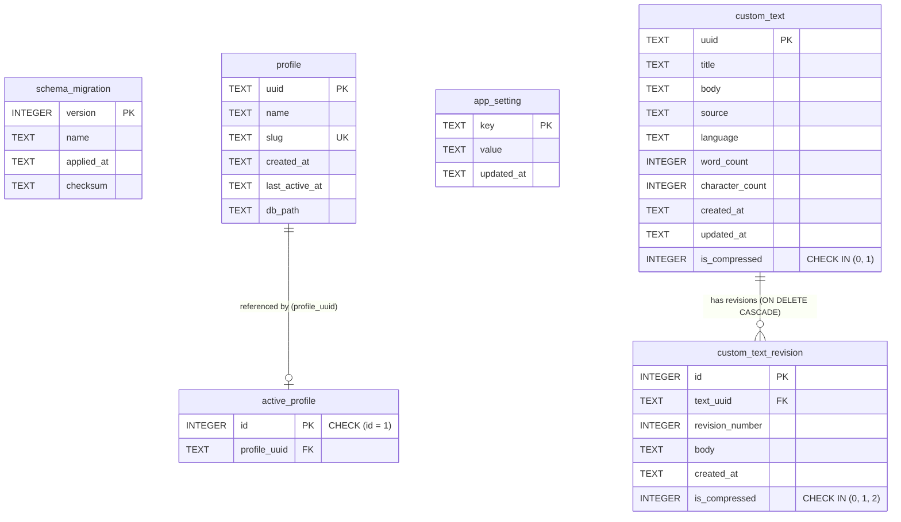
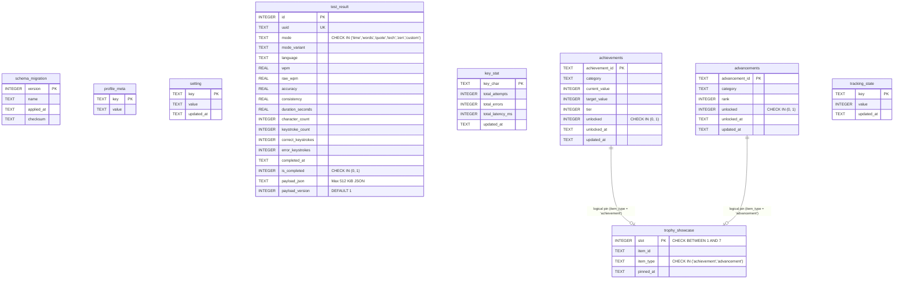

# Typing FreeX — Canonical Database Architecture & Schema Reference (v1 Baseline)

Dokumen ini merupakan referensi resmi, lengkap, dan akurat 100% mengenai arsitektur penyimpanan lokal SQLite pada aplikasi desktop **Typing FreeX** (Tauri v2 + `rusqlite`).

---

## 1. Filosofi Desain & Tata Letak File (`One-DB-Per-Profile`)

Typing FreeX menerapkan pola **Dual-Tier Isolated SQLite Architecture** sesuai **Filosofi UNIX** (*Rule of Modularity*, *Rule of Separation*, *Rule of Composition*) dan **Linus's Law** (*"Good programmers worry about data structures and their relationships"*):

1. **Global Registry Database (`registry.db`)**: Menyimpan daftar profil pengguna, pointer profil aktif saat ini, pengaturan tingkat aplikasi global (`app.*`, fallback `ui.theme` / `ui.locale`), serta pustaka teks kustom bersama (`custom_text` dan riwayat revisinya).
2. **Per-Profile Database (`profiles/<uuid>/typing_freex.db`)**: Mengisolasi seluruh data riwayat ketikan (`test_result`), statistik tombol (`key_stat`), pengaturan spesifik profil (`setting`), pencapaian (`achievements`, `advancements`, `tracking_state`), dan etalase trofi (`trophy_showcase`) ke dalam satu file mandiri per profil.

### Struktur Direktori Data Aplikasi (`app_data_dir`)

```text
<app_data_dir>/
├── registry.db                         # Database registri global & koleksi custom text
├── registry.db-wal                     # Write-Ahead Log untuk registry.db
├── registry.db-shm                     # Shared-memory index untuk WAL registry.db
├── profiles/
│   └── <profile_uuid>/
│       ├── typing_freex.db             # Database terisolasi milik satu profil pengguna
│       ├── typing_freex.db-wal         # Write-Ahead Log profil aktif
│       └── typing_freex.db-shm         # Shared-memory index WAL profil aktif
├── backups/                            # Direktori default hasil ekspor cadangan (.db + .db.sha256)
├── quarantine/                         # Ruang staging sementara saat validasi impor database (TTL 5 menit)
├── content_cache/                      # Cache paket konten luring
├── logs/                               # Berkas log aplikasi berputar (typing_freex.log, maks 5 MiB x 3 arsip)
└── temp/                               # File temporer internal aplikasi
```

> **Catatan Migrasi Direktori Legacy (`src-tauri/src/db/legacy_migrate.rs`)**: Saat aplikasi melakukan bootstrap dengan identifier kanonikal `com.typing-freex.app`, modul `db::legacy_migrate::migrate_legacy_app_data_dir()` memeriksa apakah `registry.db` belum ada di `<app_data_dir>` baru namun tersedia di direktori sibling legacy `com.typing_freex.i18n`; bila ditemukan, data profil dan registri dimigrasikan secara otomatis sebelum `DatabaseManager` diinisialisasi.

---

## 2. Konfigurasi Koneksi SQLite & Invarian Header

Setiap koneksi ke `registry.db` maupun `typing_freex.db` dikonfigurasi melalui fungsi kanonikal `db::migrate::connection::configure_connection()`:

| PRAGMA / Konstanta | Nilai Kanonikal | Tujuan & Penjelasan |
| :--- | :--- | :--- |
| `journal_mode` | `WAL` | Konkurensi baca/tulis tinggi dan latensi simpan hasil sub-20ms. |
| `synchronous` | `NORMAL` | Keseimbangan optimal antara ketahanan data WAL dan kecepatan I/O disk. |
| `foreign_keys` | `ON` | Menjaga integritas referensial antar tabel (dinonaktifkan sementara hanya di dalam transaksi migrasi, lalu diverifikasi dengan `PRAGMA foreign_key_check`). |
| `busy_timeout` | `5000` (5 detik) | Mencegah kegagalan `SQLITE_BUSY` sesaat ketika terjadi akses berurutan. |
| `application_id` | `0x54465258` (`1413894744`) | Representasi ASCII 4-byte `"TFRX"` (*Typing FreeX*). Digunakan untuk memvalidasi keaslian file saat impor database. |
| `user_version` | `2` (profil) / `1` (registry) | Versi skema aktif saat ini (`CURRENT_SCHEMA_VERSION = 2` dan `CURRENT_REGISTRY_SCHEMA_VERSION = 1`). |

---

## 3. Arsitektur Mesin Migrasi (`src-tauri/src/db/migrate/`)

Sistem migrasi dirancang mengikuti pipa modular UNIX dengan pemisahan ketat antara **mekanisme** (mesin eksekutor) dan **kebijakan** (daftar definisi skema SQL):



| Modul | Tanggung Jawab Tunggal (*Single Responsibility*) |
| :--- | :--- |
| `src-tauri/src/db/migrate/connection.rs` | Mengatur PRAGMA koneksi SQLite, konstanta `APPLICATION_ID` (`0x54465258`), dan validator `is_valid_application_id()`. |
| `src-tauri/src/db/migrate/timestamp.rs` | Fungsi murni (*pure function*) `chrono_now_iso()` dan algoritma tanggal sipil Howard Hinnant `civil_from_days()` tanpa dependensi crate waktu eksternal. |
| `src-tauri/src/db/migrate/runner.rs` | Mesin migrasi generik (`run_migration_set`) yang bebas dari pengetahuan nama tabel domain. Mengelola tabel `schema_migration`, verifikasi/rekonsiliasi SHA-256 checksum, guard penolakan versi masa depan/pra-rilis, transaksi atomik, dan `PRAGMA user_version`. |
| `src-tauri/src/db/migrate/sets.rs` | Menyimpan konstanta versi (`CURRENT_SCHEMA_VERSION = 2`, `CURRENT_REGISTRY_SCHEMA_VERSION = 1`) dan mengikat file `.sql` via `include_str!`. |
| `src-tauri/src/db/migrate/mod.rs` | Fasad antarmuka publik (`run_migrations`, `run_registry_migrations`, re-export simbol). |

---

## 4. Skema Database 1: Global Registry (`registry.db`)

Sumber DDL: `src-tauri/migrations/registry/0001_baseline.sql`

### 4.1 Diagram Relasi Entitas (`registry.db`)



### 4.2 Rincian Tabel `registry.db`

#### 1. `schema_migration` (Dikelola oleh `runner.rs`)
Mencatat riwayat versi migrasi SQL yang telah diterapkan pada `registry.db`.
- `version` (`INTEGER PRIMARY KEY`): Nomor urut versi migrasi (dimulai dari `1`).
- `name` (`TEXT NOT NULL`): Nama deskriptif migrasi (mis. `"0001_baseline"`).
- `applied_at` (`TEXT NOT NULL`): Timestamp UTC ISO-8601 saat migrasi dijalankan.
- `checksum` (`TEXT NOT NULL`): Hash SHA-256 hex (64 karakter) dari isi skrip SQL.

#### 2. `profile`
Daftar seluruh profil pengguna yang terdaftar pada instalasi aplikasi.
- `uuid` (`TEXT PRIMARY KEY`): UUID v4 unik profil.
- `name` (`TEXT NOT NULL`): Nama tampilan profil (1–32 karakter setelah validasi).
- `slug` (`TEXT NOT NULL UNIQUE`): Slug URL/file-safe unik (otomatis diberi akhiran `-2`, `-3`, dst. oleh `resolve_unique_slug` bila terjadi tabrakan nama).
- `created_at` (`TEXT NOT NULL`): Timestamp pembuatan profil (ISO-8601 UTC).
- `last_active_at` (`TEXT NOT NULL`): Timestamp terakhir kali profil diaktifkan/dipilih.
- `db_path` (`TEXT NOT NULL`): Path relatif menuju file SQLite profil, selalu berformat `profiles/<uuid>/typing_freex.db`.
- **Modul pengelola**: `src-tauri/src/db/registry.rs`, `src-tauri/src/db/manager.rs`, `src-tauri/src/commands/profile.rs`.

#### 3. `active_profile`
Tabel baris-tunggal (*singleton row*) penunjuk profil yang sedang aktif.
- `id` (`INTEGER PRIMARY KEY CHECK (id = 1)`): Mengunci tabel agar hanya memiliki maksimal 1 baris (`id = 1`).
- `profile_uuid` (`TEXT NOT NULL REFERENCES profile(uuid)`): UUID profil yang sedang aktif.

#### 4. `app_setting`
Penyimpanan key-value untuk pengaturan tingkat aplikasi yang berlaku lintas profil.
- `key` (`TEXT PRIMARY KEY`): Kunci pengaturan (mis. `app.first_run_done`, serta salinan global `ui.theme` dan `ui.locale` untuk fallback sebelum profil dimuat).
- `value` (`TEXT NOT NULL`): Nilai pengaturan dalam representasi string.
- `updated_at` (`TEXT NOT NULL`): Timestamp pembaruan terakhir (ISO-8601 UTC).
- **Modul pengelola**: `src-tauri/src/db/registry.rs`, `src-tauri/src/commands/settings.rs`.

#### 5. `custom_text`
Koleksi materi latihan teks kustom lintas profil.
- `uuid` (`TEXT PRIMARY KEY`): UUID v4 unik teks kustom.
- `title` (`TEXT NOT NULL`): Judul teks (1–100 karakter).
- `body` (`TEXT NOT NULL`): Isi teks yang telah disanitasi (1–50.000 karakter) atau payload terkompresi jika `is_compressed = 1`.
- `source` (`TEXT`): Sumber opsional (mis. `"file_import"`, `"user"`, atau `NULL`).
- `language` (`TEXT NOT NULL DEFAULT 'en'`): Kode bahasa teks.
- `word_count` (`INTEGER NOT NULL`): Jumlah kata hasil perhitungan saat sanitasi.
- `character_count` (`INTEGER NOT NULL`): Jumlah karakter Unicode (`chars().count()`).
- `created_at` (`TEXT NOT NULL`): Timestamp pembuatan (ISO-8601 UTC).
- `updated_at` (`TEXT NOT NULL`): Timestamp modifikasi atau pemakaian terakhir (`custom_text_mark_used`).
- `is_compressed` (`INTEGER NOT NULL DEFAULT 0 CHECK (is_compressed IN (0, 1))`): Flag kompresi (`0` = teks mentah UTF-8, `1` = terkompresi via `text_import::compress`).
- **Indeks**: `idx_custom_text_updated_at ON custom_text (updated_at DESC)`.
- **Modul pengelola**: `src-tauri/src/db/custom_text_repo.rs`, `src-tauri/src/text_import/service.rs`, `src-tauri/src/commands/custom_text.rs`.

#### 6. `custom_text_revision`
Riwayat revisi teks kustom dengan dukungan *Adaptive Delta Compression*.
- `id` (`INTEGER PRIMARY KEY AUTOINCREMENT`): ID internal baris revisi.
- `text_uuid` (`TEXT NOT NULL REFERENCES custom_text(uuid) ON DELETE CASCADE`): Referensi ke teks induk; otomatis terhapus jika teks induk dihapus.
- `revision_number` (`INTEGER NOT NULL`): Nomor urut revisi (`1, 2, 3, ...`) per `text_uuid`.
- `body` (`TEXT NOT NULL`): Snapshot penuh (revisi 1 atau bila snapshot lebih kecil dari delta) atau *compact line delta* terhadap revisi sebelumnya.
- `created_at` (`TEXT NOT NULL`): Timestamp revisi dibuat (ISO-8601 UTC).
- `is_compressed` (`INTEGER NOT NULL DEFAULT 0 CHECK (is_compressed IN (0, 1, 2))`):
  - `0`: Snapshot penuh tanpa kompresi.
  - `1`: Snapshot penuh terkompresi.
  - `2`: *Compact line delta* (`text_import::diff::create_compact_delta`).
- **Constraint**: `UNIQUE (text_uuid, revision_number)`.

---

## 5. Skema Database 2: Per-Profile Database (`profiles/<uuid>/typing_freex.db`)

Sumber DDL: `src-tauri/migrations/profile/0001_baseline.sql`

### 5.1 Diagram Relasi Entitas (`typing_freex.db`)



### 5.2 Rincian Tabel `typing_freex.db`

#### 1. `schema_migration` (Dikelola oleh `runner.rs`)
Identik dengan struktur pada `registry.db`, mencatat penerapan `0001_baseline` (`version = 1`) pada database profil.

#### 2. `profile_meta`
Metadata identitas mandiri di dalam file database profil agar file `.db` tetap memiliki identitas utuh saat diekspor sebagai cadangan (`VACUUM INTO`) dan diimpor ke perangkat lain.
- `key` (`TEXT PRIMARY KEY`): Kunci identitas (`'uuid'`, `'name'`, `'slug'`).
- `value` (`TEXT NOT NULL`): Nilai metadata terkait.
- **Modul pengelola**: `src-tauri/src/db/manager.rs` (saat `create_profile`), `src-tauri/src/db/validate.rs` (dibaca saat `stage_and_validate_import` dan diperbarui saat `commit_validated_import`).

#### 3. `setting`
Pengaturan spesifik profil (terisolasi penuh antar pengguna).
- `key` (`TEXT PRIMARY KEY`): Kunci pengaturan (mis. `test.mode`, `test.difficulty`, `test.forgiving_accuracy`, `sound.pack`, `sound.volume`, `caret.style`, `ui.theme`, `ui.locale`, dll.).
- `value` (`TEXT NOT NULL`): Nilai pengaturan tervalidasi (`domain::settings::validate_setting`).
- `updated_at` (`TEXT NOT NULL`): Timestamp pembaruan terakhir (ISO-8601 UTC).
- **Modul pengelola**: `src-tauri/src/commands/settings.rs`.

#### 4. `test_result`
Tabel fakta utama (*single source of truth*) untuk seluruh riwayat sesi pengetikan dan analitik profil.
- `id` (`INTEGER PRIMARY KEY AUTOINCREMENT`): ID baris berurutan internal.
- `uuid` (`TEXT NOT NULL UNIQUE`): UUID unik sesi pengetikan.
- `mode` (`TEXT NOT NULL CHECK (mode IN ('time', 'words', 'quote', 'tech', 'zen', 'custom'))`): Mode pengujian. Catatan: Hasil mode `'zen'` ditolak di tingkat command (`save_result_internal`) karena bersifat latihan bebas tanpa penyimpanan.
- `mode_variant` (`TEXT NOT NULL`): Varian mode (mis. `'15'`, `'30'`, `'60'`, `'25'`, `'short'`, `'infinity'`).
- `language` (`TEXT NOT NULL`): Bahasa atau topik teknologi (mis. `'en'`, `'english_1k'`, `'docker'`, `'rust'`).
- `wpm` (`REAL NOT NULL`): Kecepatan bersih (*Net Words Per Minute*, rentang valid `0.0..=500.0`).
- `raw_wpm` (`REAL NOT NULL`): Kecepatan mentah (*Raw WPM*, rentang valid `0.0..=600.0`).
- `accuracy` (`REAL NOT NULL`): Persentase akurasi (`0.0..=100.0`).
- `consistency` (`REAL`): Persentase konsistensi (`0.0..=100.0` atau `NULL`).
- `duration_seconds` (`REAL NOT NULL`): Durasi sesi dalam detik (`> 0.0` dan `<= 86400.0`).
- `character_count` (`INTEGER NOT NULL`): Jumlah karakter yang diketik.
- `keystroke_count` (`INTEGER NOT NULL`): Total ketukan tombol.
- `correct_keystrokes` (`INTEGER NOT NULL`): Jumlah ketukan benar.
- `error_keystrokes` (`INTEGER NOT NULL`): Jumlah ketukan salah.
- `completed_at` (`TEXT NOT NULL`): Timestamp selesai sesi (ISO-8601 UTC).
- `is_completed` (`INTEGER NOT NULL CHECK (is_completed IN (0, 1))`): Status penyelesaian (`1` = selesai; sesi tidak selesai `is_completed = false` diabaikan dan tidak pernah disimpan ke DB).
- `payload_json` (`TEXT NOT NULL`): Objek JSON detail sesi (maksimal `512 KiB` / `524.288 byte`), memuat seri per detik, konfigurasi (`$.config.difficulty`), dan rincian `$.keyStats`.
- `payload_version` (`INTEGER NOT NULL DEFAULT 1`): Versi skema payload JSON untuk kompatibilitas evolusi format payload di masa depan.
- **Indeks**:
  - `idx_test_result_mode_variant ON test_result (mode, mode_variant, completed_at DESC)`
  - `idx_test_result_completed_at ON test_result (completed_at DESC)`
  - `idx_test_result_wpm ON test_result (wpm DESC)`
  - `idx_test_result_custom ON test_result (mode, completed_at DESC) WHERE mode = 'custom'`
  - `idx_test_result_stats ON test_result (is_completed, mode, completed_at DESC)` *(ditambahkan pada migrasi `0002_indexes.sql`)*
- **Aturan Analitik vs Riwayat**:
  - Sesi dengan `mode = 'custom'` disimpan ke `test_result` dan tampil di **History** (`result_list`), tetapi **dikecualikan** dari agregasi **Analytics**, **Personal Bests**, **Daily Activity**, dan **Key Heatmap** (`mode NOT IN ('zen', 'custom')`).
  - Seluruh metrik **Personal Bests** (top 3 per tingkat kesulitan via window function `ROW_NUMBER() OVER (PARTITION BY difficulty ...)`) dan **Daily Activity** (375 hari terakhir) dihitung langsung secara akurat dari `test_result` di `src-tauri/src/commands/stats.rs`.

#### 5. `key_stat`
Agregat kumulatif akurasi dan latensi per karakter untuk fitur **Key Heatmap**.
- `key_char` (`TEXT PRIMARY KEY`): Karakter tombol yang ditekan.
- `total_attempts` (`INTEGER NOT NULL DEFAULT 0`): Total percobaan ketukan pada karakter tersebut.
- `total_errors` (`INTEGER NOT NULL DEFAULT 0`): Total kesalahan ketukan pada karakter tersebut.
- `total_latency_ms` (`INTEGER NOT NULL DEFAULT 0`): Akumulasi latensi antar-ketukan dalam milidetik.
- `updated_at` (`TEXT NOT NULL`): Timestamp pembaruan terakhir.
- **Modul pengelola**: Diperbarui secara transaksional di `results::save_result_internal` dan dibaca oleh `stats::stats_key_heatmap_internal`.

#### 6. `achievements`
Misi progresif bertingkat (*multi-tier progressive missions*, 17 misi × beberapa tier = 45 tier).
- `achievement_id` (`TEXT PRIMARY KEY`): ID kanonikal misi (mis. `'speed_tier'`, `'tests_completed'`, `'daily_streak'`).
- `category` (`TEXT NOT NULL`): Kategori misi.
- `current_value` (`INTEGER NOT NULL DEFAULT 0`): Nilai progres saat ini.
- `target_value` (`INTEGER NOT NULL`): Nilai target untuk tier aktif.
- `tier` (`INTEGER NOT NULL DEFAULT 0`): Tier tertinggi yang telah dicapai.
- `unlocked` (`INTEGER NOT NULL DEFAULT 0 CHECK (unlocked IN (0, 1))`): Status buka kunci (`0` atau `1`).
- `unlocked_at` (`TEXT`): Timestamp saat dibuka (`NULL` jika belum terbuka).
- `updated_at` (`TEXT NOT NULL`): Timestamp pembaruan terakhir.
- **Indeks**:
  - `idx_achievements_category ON achievements (category)`
  - `idx_achievements_unlocked ON achievements (unlocked, category)`
- **Modul pengelola**: `src-tauri/src/commands/achievements.rs`.

#### 7. `advancements`
Pencapaian satu-kali berbasis kelangkaan (*one-shot rarity feats*).
- `advancement_id` (`TEXT PRIMARY KEY`): ID kanonikal advancement.
- `category` (`TEXT NOT NULL`): Kategori advancement.
- `rank` (`INTEGER NOT NULL DEFAULT 0`): Tingkat kelangkaan/rank.
- `unlocked` (`INTEGER NOT NULL DEFAULT 0 CHECK (unlocked IN (0, 1))`): Status buka kunci (`0` atau `1`).
- `unlocked_at` (`TEXT`): Timestamp saat dibuka (`NULL` jika belum terbuka).
- `updated_at` (`TEXT NOT NULL`): Timestamp pembaruan terakhir.
- **Indeks**:
  - `idx_advancements_category ON advancements (category)`
  - `idx_advancements_unlocked ON advancements (unlocked, category)`
- **Modul pengelola**: `src-tauri/src/commands/advancements.rs`.

#### 8. `tracking_state`
Penghitung state evaluasi internal mesin pencapaian (mis. streak sempurna, eksplorasi bitmask/counter).
- `key` (`TEXT PRIMARY KEY`): Kunci state internal.
- `value` (`INTEGER NOT NULL DEFAULT 0`): Nilai integer 64-bit.
- `updated_at` (`TEXT NOT NULL`): Timestamp pembaruan terakhir.
- **Modul pengelola**: `src-tauri/src/commands/tracking_state.rs`.

#### 9. `trophy_showcase`
Etalase 7 slot trofi pilihan pengguna pada halaman profil.
- `slot` (`INTEGER PRIMARY KEY CHECK (slot BETWEEN 1 AND 7)`): Nomor slot etalase (`1` sampai `7`).
- `item_id` (`TEXT`): ID `achievement_id` atau `advancement_id` yang dipasang.
- `item_type` (`TEXT CHECK (item_type IS NULL OR item_type IN ('achievement', 'advancement'))`): Diskriminator polimorfik jenis trofi.
- `pinned_at` (`TEXT NOT NULL`): Timestamp saat trofi dipasang ke slot.
- **Aturan Integritas**: `trophy_showcase_set` memverifikasi bahwa trofi yang dipasang sudah terbuka (`unlocked = 1` atau `tier > 0` untuk achievement) dan otomatis menghapus pin lama jika trofi yang sama dipindahkan dari slot lain.
- **Modul pengelola**: `src-tauri/src/commands/trophy_showcase.rs`.

---

## 6. Matriks Lokasi Data & Cakupan Backup

| Jenis Data | Database Penyimpanan | Ikut Dalam Backup Profil (`VACUUM INTO`)? | Keterangan |
| :--- | :--- | :--- | :--- |
| Daftar Profil & Profil Aktif | `registry.db` (`profile`, `active_profile`) | Tidak | Direkonstruksi otomatis saat impor profil baru dengan UUID & slug bebas benturan. |
| Pengaturan Global (`app.*`) | `registry.db` (`app_setting`) | Tidak | Berlaku untuk instalasi aplikasi lokal. |
| Koleksi Teks Kustom & Revisi | `registry.db` (`custom_text`, `custom_text_revision`) | Tidak | Dibagikan lintas profil; memiliki fitur Impor/Ekspor file `.txt` tersendiri. |
| Identitas Profil (`profile_meta`) | `typing_freex.db` | **Ya** | Menyimpan `uuid`, `name`, dan `slug` profil asal. |
| Pengaturan Profil (`setting`) | `typing_freex.db` | **Ya** | Seluruh preferensi arena, suara, tema, dan bahasa profil. |
| Riwayat & Analitik (`test_result`, `key_stat`) | `typing_freex.db` | **Ya** | Mencakup seluruh sesi, grafik, PB, daily activity, dan heatmap. |
| Pencapaian & Etalase (`achievements`, `advancements`, `tracking_state`, `trophy_showcase`) | `typing_freex.db` | **Ya** | Seluruh progres misi, advancement, dan 7 slot trofi. |

---

## 7. Pipa Keamanan Impor Database (10-Stage Quarantine Pipeline)

Saat pengguna mengimpor file database eksternal (`db_import_pick` → `db::validate::stage_and_validate_import`), file tidak pernah langsung disentuh oleh koneksi profil aktif, melainkan melewati 10 tahap validasi ketat:

1. **Validasi File & Ukuran**: Memastikan file reguler berekstensi `.db`, `.sqlite`, atau `.sqlite3` dengan ukuran antara `512 byte` hingga `2 GiB`.
2. **Isolasi Karantina**: Menyalin file ke `<app_data_dir>/quarantine/<staging_token>.db` (TTL 5 menit).
3. **Verifikasi Checksum SHA-256**: Menghitung hash SHA-256 dan mencocokkannya dengan file sidecar `.sha256` bila tersedia.
4. **Inspeksi Magic Header**: Memastikan 16 byte pertama persis bernilai `b"SQLite format 3\0"`.
5. **Koneksi Defensif Read-Only**: Membuka database dengan `SQLITE_OPEN_READ_ONLY | SQLITE_OPEN_NO_MUTEX` serta `PRAGMA query_only = ON; PRAGMA trusted_schema = OFF;`.
6. **Validasi `application_id`**: Memastikan `PRAGMA application_id` bernilai `0x54465258` (`TFRX`) atau `0`.
7. **Validasi `user_version`**: Menolak database dengan `user_version > CURRENT_SCHEMA_VERSION`.
8. **Pemeriksaan Integritas & Allowlist Objek**: Menjalankan `PRAGMA integrity_check`, menolak segala bentuk `trigger` atau `view` berbahaya, dan memastikan setiap tabel berada di dalam `ALLOWED_TABLES`:
   - `schema_migration`, `profile_meta`, `setting`, `test_result`, `key_stat`, `achievements`, `advancements`, `tracking_state`, `trophy_showcase`, `sqlite_sequence`.
9. **Batas Ukuran Payload**: Menolak database jika terdapat baris `test_result` dengan `length(payload_json) > 524288` (512 KiB).
10. **Komit Atomik Tanpa Timpa (`commit_validated_import`)**: Saat disetujui pengguna, database karantina dipindahkan ke direktori profil baru dengan UUID v4 baru dan slug unik sehingga tidak pernah menimpa profil yang sudah ada.

---

## 8. Tata Kelola Evolusi Skema di Masa Depan

1. **Baseline v1 Terkunci**: File `migrations/profile/0001_baseline.sql` dan `migrations/registry/0001_baseline.sql` adalah fondasi rilis v0.1.0. Setelah rilis publik, perubahan skema baru ditambahkan sebagai migrasi berurutan (`0002_<deskripsi>.sql`, dst.) pada `sets.rs` disertai peningkatan `CURRENT_SCHEMA_VERSION` / `CURRENT_REGISTRY_SCHEMA_VERSION`.
2. **Larangan Penomoran Versi pada Nama Tabel/Kolom**: Nama tabel dan kolom wajib selalu menggunakan nama domain kanonikal murni tanpa akhiran `_v1`, `_v2`, dst. Jika diperlukan rekonstruksi tabel SQLite pada migrasi mendatang, gunakan tabel sementara `<nama_tabel>_new`, salin data, hapus tabel lama, lalu `ALTER TABLE <nama_tabel>_new RENAME TO <nama_tabel>`.
3. **Sinkronisasi Wajib**: Setiap penambahan tabel di masa depan wajib memperbarui `ALLOWED_TABLES` di `src-tauri/src/db/validate.rs`, unit test skema di `src-tauri/src/db/migrate/mod.rs`, serta dokumen `docs/database-schema.md` ini dalam satu perubahan yang sama.

